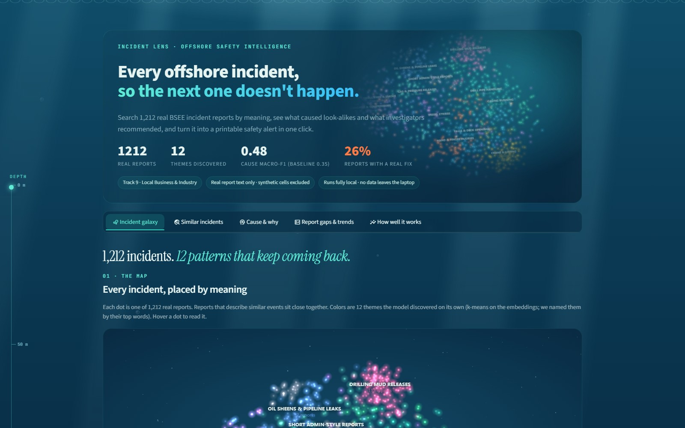
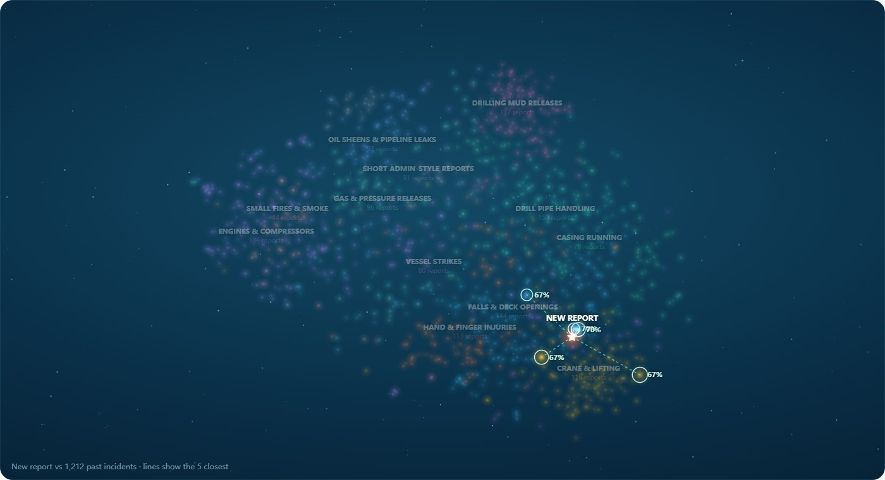
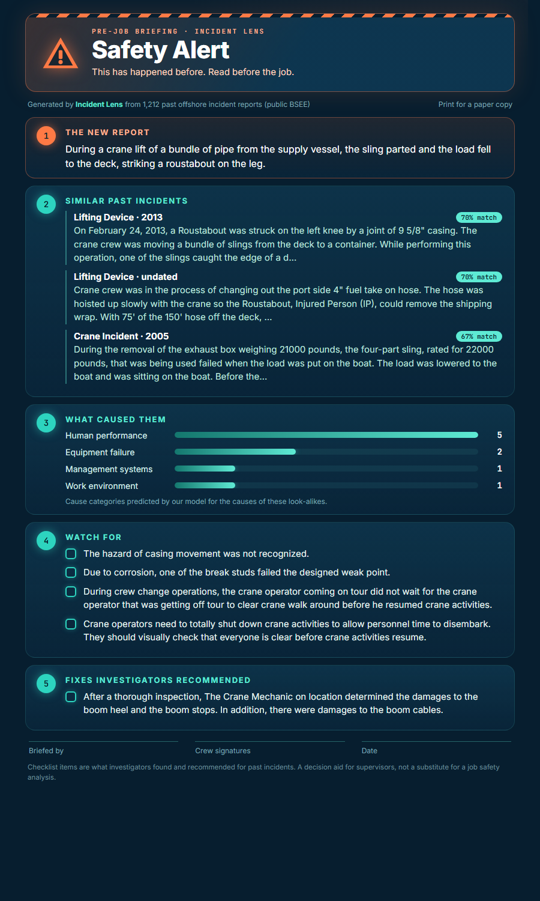
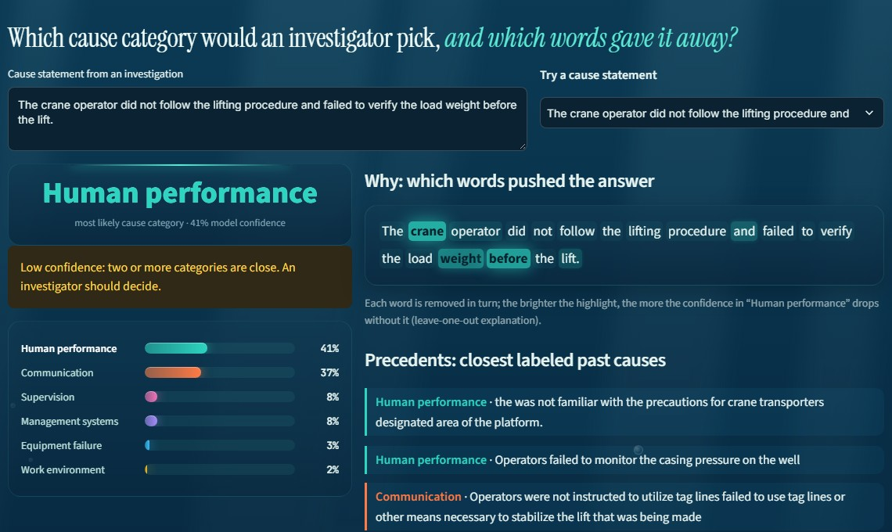
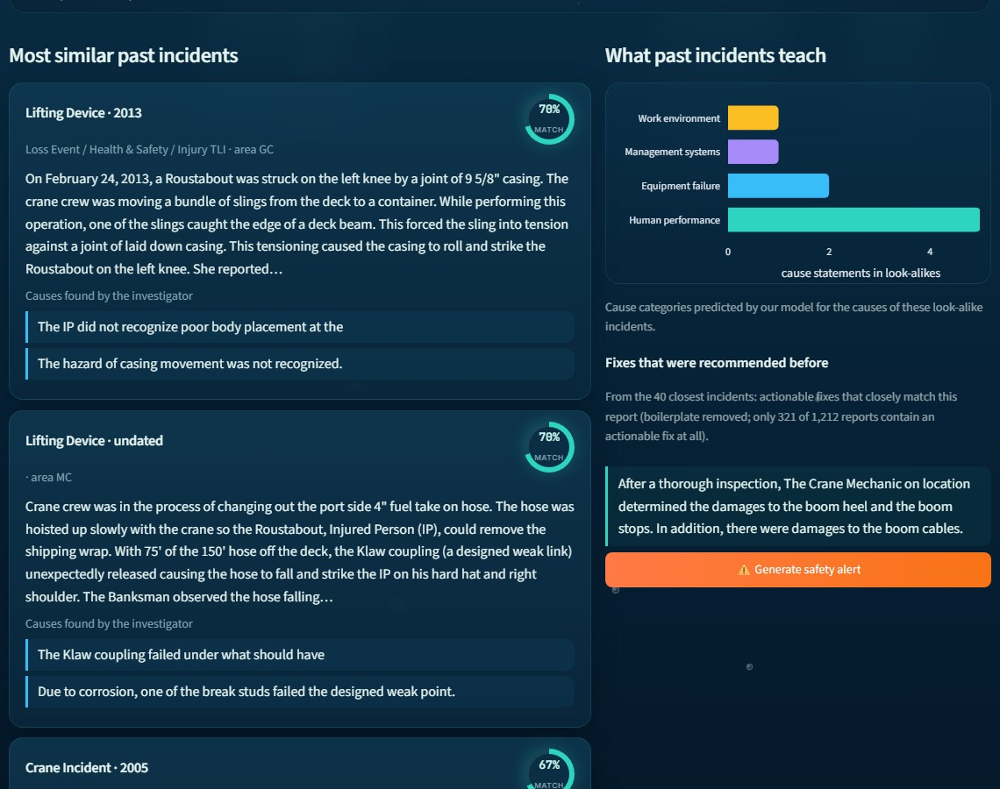

# Incident Lens

**HAI Hackathon 2026 · Track 9 (Local Business & Industry) · Learn from offshore incident reports**

**Try it live: https://incident-lens.streamlit.app**



| A new report lands among past incidents | One click: a printable safety alert |
|---|---|
|  |  |
| **Cause & why: the words behind the answer** | **Similar incidents, causes and fixes** |
|  |  |

Helps offshore safety teams learn from ~1,200 real incident reports without reading every one:

1. **Similar incidents**: paste a new report, get the most similar past incidents with their causes and recommended fixes (local `bge-small` embeddings, cosine similarity).
2. **Cause & why**: predicts the investigator's cause category (6 classes) and highlights which words drove the prediction (leave-one-word-out), plus the closest labeled precedents.
3. **Report gaps**: flags reports missing causes, recommendations, outcome or date.
4. **How well it works**: an honest evaluation page.

## Results (cause category, 2019+ era, n = 374, 5 folds grouped by incident)

| Method | Macro-F1 | 95% CI (bootstrap over incidents) |
|---|---|---|
| Always guess most common class | 0.08 | – |
| Official baseline: TF-IDF + logistic regression | 0.35 | 0.29–0.40 |
| **Incident Lens: embeddings + logistic regression** | **0.48** | **0.42–0.54** |

Scores measure agreement with the BSEE investigator's category, not the "true" cause. Hyper-parameters were set once, not tuned on test folds.

## Data
[Houston-AI-Institute/psm-incident-ml](https://github.com/Houston-AI-Institute/psm-incident-ml): public US federal offshore incident reports (BSEE). We use only the `real_only/` tables (synthetic cells blanked). Data is **not** included in this repo; no names are shown in the app.

## Run
```bash
git clone https://github.com/Houston-AI-Institute/psm-incident-ml  # set DATA path in build.py / evaluate.py
uv sync
uv run python build.py      # embeddings for the search index
uv run python evaluate.py   # classifier comparison + models
uv run streamlit run app.py
```

Runs fully local: no API keys, no data leaves the machine. MIT license.
